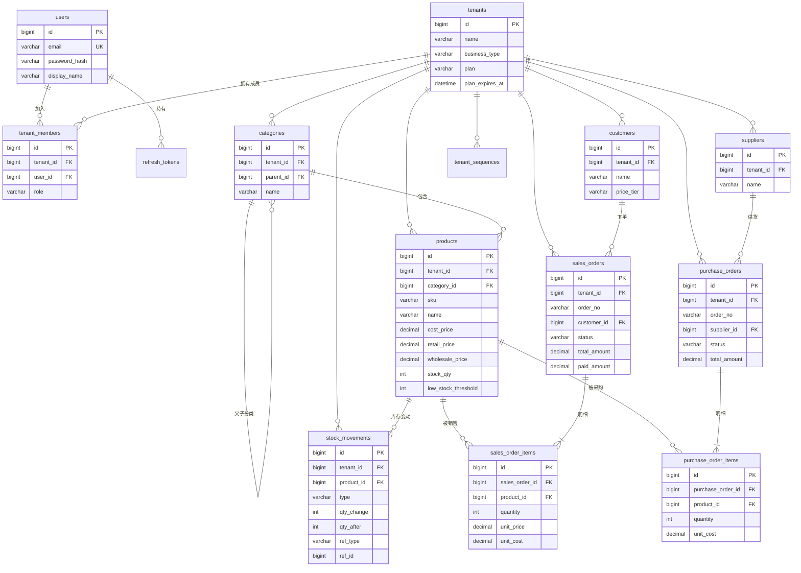

# 02 · 数据库设计 —— SmallBiz Manager

MySQL 8，字符集 `utf8mb4`，排序规则 `utf8mb4_0900_ai_ci`，引擎 InnoDB。所有表结构由 Flyway 迁移脚本创建（`V1__init.sql` 起）。

## 1. ER 图

## 2. 通用约定

- 主键：`id BIGINT AUTO_INCREMENT`。对外 API 也使用 id，但跨商户访问一律 404，因此不会泄露数据。
- 所有业务表都有：`tenant_id BIGINT NOT NULL`、`created_at DATETIME(3)`、`updated_at DATETIME(3)`、`created_by BIGINT NULL`。
- 有并发修改风险的表加 `version INT`（JPA `@Version` 乐观锁），防止两个人同时编辑互相覆盖。
- 被订单引用的数据（商品、客户、供应商）采用**软删除**：`deleted_at DATETIME NULL`，历史订单仍可显示原名称。
- 金额：`DECIMAL(14,2)`；数量：`INT`（MVP 只支持整数件数，商品有 `unit` 单位字段如"件/箱/个"；按重量/长度的小数数量放到后续版本）。
- 枚举存 `VARCHAR`（例如 `'COMPLETED'`），比 MySQL ENUM 更易扩展。
- 时间统一存 UTC。

## 3. 表结构

### 3.1 账号与商户

**users** —— 登录账号（全局，不属于某个商户）

| 字段 | 类型 | 约束 | 说明 |
|---|---|---|---|
| id | BIGINT | PK | |
| email | VARCHAR(191) | NOT NULL, UNIQUE | 登录名（统一转小写） |
| password_hash | VARCHAR(100) | NOT NULL | BCrypt |
| display_name | VARCHAR(100) | NOT NULL | 昵称 |
| phone | VARCHAR(30) | NULL | |
| status | VARCHAR(20) | NOT NULL DEFAULT 'ACTIVE' | ACTIVE / DISABLED |
| is_platform_admin | BOOLEAN | NOT NULL DEFAULT FALSE | 平台管理员（只有运营者本人），可进入 `/admin` |
| last_login_at | DATETIME(3) | NULL | |
| created_at / updated_at | DATETIME(3) | | |

**tenants** —— 商户（店铺/公司）

| 字段 | 类型 | 约束 | 说明 |
|---|---|---|---|
| id | BIGINT | PK | |
| name | VARCHAR(100) | NOT NULL | 店铺名称 |
| business_type | VARCHAR(30) | NOT NULL | WHOLESALE / RETAIL / TRADING / ECOMMERCE / OTHER |
| currency | CHAR(3) | NOT NULL DEFAULT 'CNY' | 第一阶段只用于显示 |
| timezone | VARCHAR(50) | NOT NULL DEFAULT 'Asia/Shanghai' | |
| allow_negative_stock | BOOLEAN | NOT NULL DEFAULT FALSE | |
| plan | VARCHAR(20) | NOT NULL DEFAULT 'FREE' | FREE / STANDARD / PRO |
| plan_expires_at | DATETIME(3) | NULL | 为空 = 免费版；到期后按免费版处理 |
| trial_used | BOOLEAN | NOT NULL DEFAULT FALSE | 是否已用过首月 1.99 元体验 |
| contact_phone / address | VARCHAR | NULL | 打印单据用 |
| created_at / updated_at | DATETIME(3) | | |

**tenant_members** —— 用户与商户的关系及角色

| 字段 | 类型 | 约束 | 说明 |
|---|---|---|---|
| id | BIGINT | PK | |
| tenant_id | BIGINT | FK → tenants | |
| user_id | BIGINT | FK → users | |
| role | VARCHAR(20) | NOT NULL | OWNER / ADMIN / STAFF |
| status | VARCHAR(20) | NOT NULL DEFAULT 'ACTIVE' | ACTIVE / INVITED / REMOVED |
| | | UNIQUE(tenant_id, user_id) | |

**refresh_tokens**

| 字段 | 类型 | 说明 |
|---|---|---|
| id | BIGINT PK | |
| user_id | BIGINT FK | |
| token_hash | CHAR(64) UNIQUE | SHA-256，原文不入库 |
| expires_at | DATETIME(3) | |
| revoked_at | DATETIME(3) NULL | 退出登录时写入 |

**tenant_sequences** —— 单号生成

| 字段 | 类型 | 说明 |
|---|---|---|
| tenant_id | BIGINT | 复合主键之一 |
| seq_key | VARCHAR(30) | 复合主键之一，如 `SO-20261108` |
| next_value | INT | 使用 `SELECT … FOR UPDATE` 取号并 +1 |

### 3.2 商品

**categories** —— 商品分类（最多两级）

| 字段 | 类型 | 约束 | 说明 |
|---|---|---|---|
| id | BIGINT | PK | |
| tenant_id | BIGINT | NOT NULL | |
| parent_id | BIGINT | NULL, FK → categories | 为空表示一级分类 |
| name | VARCHAR(50) | NOT NULL | |
| sort_order | INT | DEFAULT 0 | |
| | | UNIQUE(tenant_id, parent_id, name) | |

> 删除分类：如果分类下还有商品，拒绝删除并提示。

**products**

| 字段 | 类型 | 约束 | 说明 |
|---|---|---|---|
| id | BIGINT | PK | |
| tenant_id | BIGINT | NOT NULL | |
| category_id | BIGINT | NULL, FK | |
| sku | VARCHAR(64) | NOT NULL | 可用户填写，留空时自动生成 |
| name | VARCHAR(200) | NOT NULL | |
| description | TEXT | NULL | |
| image_url | VARCHAR(500) | NULL | MVP 一个主图 |
| unit | VARCHAR(20) | NOT NULL DEFAULT '件' | |
| barcode | VARCHAR(64) | NULL | 为第二阶段扫码预留 |
| cost_price | DECIMAL(14,2) | NOT NULL DEFAULT 0 | 移动加权平均成本 |
| retail_price | DECIMAL(14,2) | NOT NULL DEFAULT 0 | |
| wholesale_price | DECIMAL(14,2) | NULL | 为空时批发按零售价 |
| stock_qty | INT | NOT NULL DEFAULT 0 | 只能经由库存服务修改 |
| low_stock_threshold | INT | NOT NULL DEFAULT 0 | |
| status | VARCHAR(20) | NOT NULL DEFAULT 'ACTIVE' | ACTIVE / INACTIVE（下架） |
| version | INT | | 乐观锁 |
| deleted_at | DATETIME(3) | NULL | 软删除 |
| | | UNIQUE(tenant_id, sku) | 软删除时 sku 改写为 `原sku#删除时间戳` 以释放 SKU |
| | | INDEX(tenant_id, category_id), INDEX(tenant_id, name) | |

### 3.3 库存

**stock_movements** —— 库存流水（只增不改）

| 字段 | 类型 | 说明 |
|---|---|---|
| id | BIGINT PK | |
| tenant_id | BIGINT | |
| product_id | BIGINT FK | |
| type | VARCHAR(20) | STOCK_IN 手工入库 / STOCK_OUT 手工出库 / ADJUSTMENT 盘点调整 / SALE 销售 / SALE_CANCEL 销售取消 / PURCHASE_RECEIVE 采购收货 |
| qty_change | INT | 正数增加、负数减少 |
| qty_before | INT | |
| qty_after | INT | |
| unit_cost | DECIMAL(14,2) NULL | 入库成本（手工入库可填写） |
| ref_type | VARCHAR(20) NULL | SALES_ORDER / PURCHASE_ORDER |
| ref_id | BIGINT NULL | 来源单据 id |
| reason | VARCHAR(200) NULL | 备注，如"盘点差异""损耗" |
| created_by | BIGINT | 操作人 |
| created_at | DATETIME(3) | |
| | | INDEX(tenant_id, product_id, created_at)、INDEX(tenant_id, created_at) |

### 3.4 客户与供应商

**customers**

| 字段 | 类型 | 说明 |
|---|---|---|
| id, tenant_id | BIGINT | |
| name | VARCHAR(100) NOT NULL | |
| phone / email | VARCHAR | NULL |
| address | VARCHAR(300) NULL | |
| customer_type | VARCHAR(20) | INDIVIDUAL 个人 / BUSINESS 企业 |
| price_tier | VARCHAR(20) | RETAIL / WHOLESALE，开单时默认价格 |
| notes | TEXT NULL | |
| deleted_at | DATETIME NULL | 软删除 |
| | | INDEX(tenant_id, name)、INDEX(tenant_id, phone) |

> "历史订单""累计消费金额"不存冗余字段，由 `sales_orders` 实时汇总（带索引，数据量在中小商户规模下足够快）。

**suppliers**

| 字段 | 类型 | 说明 |
|---|---|---|
| id, tenant_id | BIGINT | |
| name | VARCHAR(100) NOT NULL | |
| contact_person | VARCHAR(50) NULL | |
| phone / email / address | VARCHAR | NULL |
| supplied_products_note | VARCHAR(500) NULL | "供应商品"的文字描述；实际供货关系由采购单明细体现 |
| notes | TEXT NULL | |
| deleted_at | DATETIME NULL | |

### 3.5 销售

**sales_orders**

| 字段 | 类型 | 说明 |
|---|---|---|
| id, tenant_id | BIGINT | |
| order_no | VARCHAR(30) | UNIQUE(tenant_id, order_no) |
| customer_id | BIGINT NULL | 为空 = 散客 |
| customer_name_snapshot | VARCHAR(100) NULL | 下单时客户名快照 |
| price_tier | VARCHAR(20) | 本单使用的价格类型 |
| status | VARCHAR(20) | COMPLETED / CANCELLED |
| order_date | DATETIME(3) | 业务日期（可补录过去日期） |
| subtotal | DECIMAL(14,2) | 明细合计 |
| discount_amount | DECIMAL(14,2) DEFAULT 0 | 整单优惠 |
| total_amount | DECIMAL(14,2) | 应收 = subtotal − discount |
| paid_amount | DECIMAL(14,2) DEFAULT 0 | 已收（为应收账款模块预留，MVP 默认 = total） |
| payment_status | VARCHAR(20) | PAID / PARTIAL / UNPAID |
| notes | VARCHAR(500) NULL | |
| cancelled_at / cancelled_by | | |
| | | INDEX(tenant_id, order_date)、INDEX(tenant_id, customer_id) |

**sales_order_items**

| 字段 | 类型 | 说明 |
|---|---|---|
| id | BIGINT | |
| tenant_id | BIGINT | 冗余，方便隔离校验和报表 |
| sales_order_id | BIGINT FK | |
| product_id | BIGINT FK | |
| product_name_snapshot / sku_snapshot | VARCHAR | 商品改名后历史单据不变 |
| quantity | INT | > 0 |
| unit_price | DECIMAL(14,2) | 实际成交单价 |
| unit_cost | DECIMAL(14,2) | 销售时成本快照，算毛利用 |
| line_total | DECIMAL(14,2) | quantity × unit_price |

### 3.6 采购

**purchase_orders**

| 字段 | 类型 | 说明 |
|---|---|---|
| id, tenant_id | BIGINT | |
| order_no | VARCHAR(30) | UNIQUE(tenant_id, order_no) |
| supplier_id | BIGINT NOT NULL | |
| status | VARCHAR(20) | DRAFT / ORDERED / RECEIVED / CANCELLED |
| order_date | DATETIME(3) | |
| expected_date | DATE NULL | 预计到货 |
| received_at / received_by | | |
| total_amount | DECIMAL(14,2) | |
| notes | VARCHAR(500) NULL | |
| version | INT | |

**purchase_order_items**

| 字段 | 类型 | 说明 |
|---|---|---|
| id, tenant_id | BIGINT | |
| purchase_order_id | BIGINT FK | |
| product_id | BIGINT FK | |
| quantity | INT | > 0 |
| received_qty | INT DEFAULT 0 | 为部分收货预留 |
| unit_cost | DECIMAL(14,2) | 采购单价 |
| line_total | DECIMAL(14,2) | |

### 3.7 套餐开通（平台级）

**activation_code_batches** —— 激活码批次

| 字段 | 类型 | 说明 |
|---|---|---|
| id | BIGINT PK | |
| name | VARCHAR(100) | 如"2026-11 小红书首月体验" |
| plan | VARCHAR(20) | STANDARD / PRO |
| duration_days | INT | 30 / 365 等 |
| is_trial | BOOLEAN | 是否首月体验码（每商户限一次） |
| quantity | INT | 生成数量 |
| expires_at | DATETIME(3) NULL | 激活码本身的兑换截止时间 |
| created_by | BIGINT | 平台管理员 |
| created_at | DATETIME(3) | |

**activation_codes**

| 字段 | 类型 | 说明 |
|---|---|---|
| id | BIGINT PK | |
| batch_id | BIGINT FK | |
| code_hash | CHAR(64) UNIQUE | SHA-256；原文只在生成时导出一次 |
| code_hint | VARCHAR(8) | 末 4 位，方便客服核对，如 `9H3D` |
| status | VARCHAR(20) | UNUSED / REDEEMED / VOIDED（作废，用于退款） |
| redeemed_tenant_id | BIGINT NULL | |
| redeemed_by | BIGINT NULL | |
| redeemed_at | DATETIME(3) NULL | |

**plan_change_logs** —— 套餐变更记录（每次开通/续期/手动调整都记一条，便于对账和处理纠纷）

| 字段 | 类型 | 说明 |
|---|---|---|
| id | BIGINT PK | |
| tenant_id | BIGINT | |
| source | VARCHAR(20) | ACTIVATION_CODE / MANUAL_PAYMENT / ADMIN_MANUAL |
| activation_code_id | BIGINT NULL | |
| payment_order_id | BIGINT NULL | 来自扫码付款单时填写 |
| old_plan / new_plan | VARCHAR(20) | |
| old_expires_at / new_expires_at | DATETIME(3) | |
| operator_id | BIGINT | |
| note | VARCHAR(200) NULL | |
| created_at | DATETIME(3) | |

**plan_prices** —— 各币种价格（平台级，后台可改）

| 字段 | 类型 | 说明 |
|---|---|---|
| id | BIGINT PK | |
| plan | VARCHAR(20) | STANDARD / PRO |
| period | VARCHAR(20) | TRIAL_MONTH 首月体验 / MONTH / YEAR |
| duration_days | INT | 30 / 30 / 365 |
| currency | CHAR(3) | CNY / MYR |
| amount | DECIMAL(10,2) | 如 1.99、19.90、168.00 |
| enabled | BOOLEAN | 例如专业版在第二阶段功能完成前设为 false |
| | | UNIQUE(plan, period, currency) |

初始数据：

| 套餐 | 周期 | CNY | MYR |
|---|---|---|---|
| STANDARD | 首月体验 | 1.99 | 1.00 |
| STANDARD | 月 | 19.90 | 12.90 |
| STANDARD | 年 | 168.00 | 109.00 |
| PRO | 月 | 39.90 | 25.90 |
| PRO | 年 | 328.00 | 209.00 |

**payment_methods** —— 收款方式（平台级）

| 字段 | 类型 | 说明 |
|---|---|---|
| id | BIGINT PK | |
| code | VARCHAR(30) UNIQUE | WECHAT_PAY / TNG_DUITNOW |
| display_name | VARCHAR(50) | "微信支付" / "Touch 'n Go / DuitNow" |
| currency | CHAR(3) | CNY / MYR |
| qr_image_url | VARCHAR(500) | 收款码图片（后台上传） |
| payee_name | VARCHAR(100) | 收款人显示名，方便用户核对 |
| instructions | TEXT | 付款说明，如"请使用微信扫一扫""可用任意马来西亚银行 App 或电子钱包扫码" |
| enabled | BOOLEAN | |
| sort_order | INT | |

**payment_orders** —— 扫码付款单（属于某个商户）

| 字段 | 类型 | 说明 |
|---|---|---|
| id | BIGINT PK | |
| tenant_id | BIGINT | |
| order_no | VARCHAR(30) UNIQUE | 如 `PAY-20261108-0001` |
| reference_code | VARCHAR(12) UNIQUE | 付款备注码，如 `SBZ-7Q3K` |
| plan_price_id | BIGINT FK | |
| plan / period / duration_days | | 下单时快照 |
| currency | CHAR(3) | |
| amount | DECIMAL(10,2) | 应付金额快照 |
| payment_method_id | BIGINT FK | |
| status | VARCHAR(20) | AWAITING_PAYMENT / PENDING_REVIEW / APPROVED / REJECTED / EXPIRED / CANCELLED / REFUNDED |
| proof_image_path | VARCHAR(500) NULL | 付款截图（私有存储，不对外公开） |
| transaction_ref | VARCHAR(100) NULL | 用户填写的交易单号；非空时全局唯一 |
| payer_note | VARCHAR(300) NULL | |
| expires_at | DATETIME(3) | 创建后 24 小时 |
| submitted_at | DATETIME(3) NULL | 点"我已付款"的时间 |
| reviewed_by / reviewed_at | | 审核人与时间 |
| reject_reason | VARCHAR(200) NULL | |
| created_by | BIGINT | |
| created_at / updated_at | DATETIME(3) | |
| version | INT | 防止重复审核 |
| | | INDEX(status, submitted_at)、INDEX(tenant_id, created_at) |

### 3.8 客服（平台级，无 tenant_id）

**support_faqs** —— 话术库

| 字段 | 类型 | 说明 |
|---|---|---|
| id | BIGINT PK | |
| category | VARCHAR(30) | 账号 / 商品 / 库存 / 销售 / 采购 / 报表 / 套餐 / 其他 |
| question | VARCHAR(200) | 标准问题，显示为按钮或标题 |
| keywords | VARCHAR(500) | 关键词和同义词，逗号分隔，如 `添加商品,新增商品,上架,录入商品` |
| answer | TEXT | 标准回答（支持简单 Markdown） |
| action_label / action_path | VARCHAR NULL | 可选的跳转按钮，如"去添加商品" → `/products/new` |
| is_quick_reply | BOOLEAN | 是否显示在欢迎语下方的快捷按钮 |
| sort_order | INT | |
| enabled | BOOLEAN | |
| helpful_count / unhelpful_count | INT | 👍 / 👎 统计 |
| updated_at | DATETIME(3) | |

**support_unmatched_queries** —— 没答上来的问题

| 字段 | 类型 | 说明 |
|---|---|---|
| id | BIGINT PK | |
| query_text | VARCHAR(300) | 用户原话（截断到 300 字） |
| normalized_text | VARCHAR(300) | 去空格、转小写，用于合并相同问题 |
| occurrences | INT | 出现次数 |
| last_seen_at | DATETIME(3) | |
| resolved | BOOLEAN | 管理员补充话术后标记已处理 |

## 4. 第二阶段预留的表（现在不建）

| 表 | 用途 |
|---|---|
| `payments` | 应收账款：每笔收款记录（客户、订单、金额、日期、方式） |
| `customer_prices` | 客户专属协议价 |
| `warehouses` + `warehouse_stock` | 多仓库库存 |
| `invitations` | 员工邀请链接 |
| 在线支付回调字段 | 接入微信支付/支付宝/DuitNow 商户 API 后，在 `payment_orders` 上增加渠道交易号等字段，支付成功自动开通，无需人工审核 |
| `audit_logs` | 敏感操作审计 |
